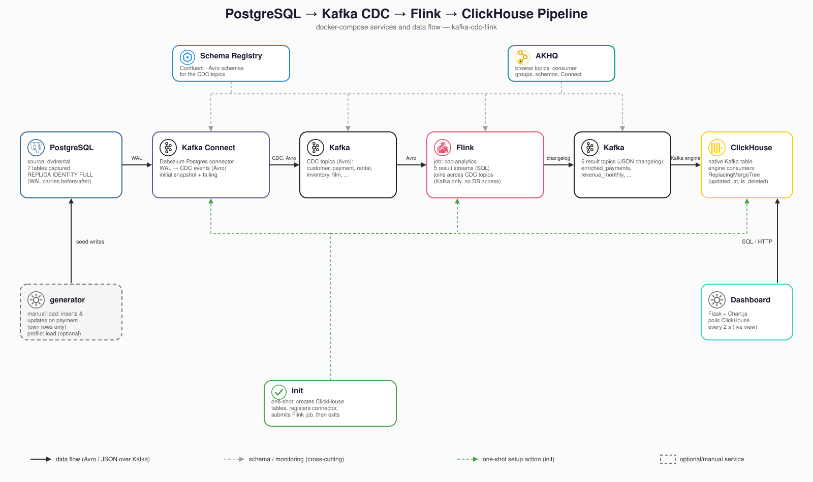

# Kafka CDC Flink

Streaming CDC pipeline: PostgreSQL (dvdrental) → Debezium → Kafka → Flink → ClickHouse, with a Flask dashboard on top that shows the results live.
CDC topics use Avro (Confluent Schema Registry); result topics carry a Debezium-style JSON changelog.

## Architecture



- **Debezium** snapshots then tails the WAL of seven tables: `customer`, `payment`, `rental`, `inventory`, `film`, `film_category`, `category`.
- **Flink** (one job, `cdc-analytics`) reads only Kafka, joins the topics, and writes five result topics. It never queries Postgres, so a changed dimension row (say, a renamed category) flows through like a new payment.
- **ClickHouse** reads the result topics itself through Kafka-engine tables.
- **dashboard** (Flask) polls ClickHouse every 2 s and charts the five datamarts, so changes show up live.
- **generator** (optional) keeps `payment` and `rental` changing since the dump is static: varied sales, returns, re-pricing, and refunds. It touches only rows it created and starts only on request (see [Run it](#run-it)).

Notes:

- Captured tables use `REPLICA IDENTITY FULL` (`postgres/init/`) so updates and deletes carry the old row, which Flink needs for retractions.
- The publication and replica identity are created only when the Postgres volume is first initialised. To capture another table, add it to `table.include.list` in `debezium/postgres-connector.json` and to `postgres/init/`, then start clean (`docker compose --profile "*" down -v`).
- The joins are regular streaming joins and keep both sides in Flink state. That is cheap for dvdrental; for large tables use `table.exec.state.ttl` or temporal joins.

## Analytics

| ClickHouse table      | What it answers                                | How Flink computes it            |
|------------------------|------------------------------------------------|----------------------------------|
| `enriched_payments`    | Revenue per customer, 1-minute windows         | Window TVF + changelog join      |
| `revenue_monthly`      | Revenue per calendar month                     | Regular aggregate                |
| `revenue_by_category`  | Revenue per film category                      | 4 chained changelog joins        |
| `top_customers`        | Top 20 spenders, continuously re-ranked        | Changelog join + unbounded Top-N |
| `store_rental_stats`   | Avg rental length, late-return ratio per store | 2 changelog joins + aggregate    |

All tables match Postgres exactly. (`payment` uses a 30-day watermark because the snapshot replays rows out of event-time order; a tighter one dropped ~19% of revenue.)

## Only the latest data

The result tables keep the current state only, no history, and follow source inserts, updates, and deletes. Flink writes a changelog and ClickHouse's `ReplacingMergeTree(updated_at, is_deleted)` keeps the newest row per key (see the comments in `clickhouse/init.sql` and `flink/sql/pipeline.sql`).

- The server sets `final = 1`, so plain `SELECT`s never see old versions or deleted rows and dashboards can query the tables directly. `SETTINGS final = 0` shows them. `is_deleted` is bookkeeping; ignore it.
- Old versions are merged away on disk within about 30-60 s of a change.

```sql
SELECT * FROM revenue_by_category ORDER BY revenue DESC;
```

## Prerequisites

- Docker + Docker Compose (v2.23+, for the inline `configs:` block)
- `data/dvdrental.tar` (already included)

## Services

| Service         | Version                                   | URL                   | Purpose                                                |
|-----------------|-------------------------------------------|-----------------------|--------------------------------------------------------|
| Postgres        | 17                                        | localhost:5432        | Source database (dvdrental)                            |
| Kafka (KRaft)   | 4.3.0 (Debezium image 3.6)                | localhost:9092        | Event backbone                                         |
| Schema Registry | Confluent 8.3.0                           | http://localhost:8085 | Avro schemas for the CDC topics                        |
| Kafka Connect   | Confluent 8.3.0, Debezium Postgres 3.7.0 | http://localhost:8083 | Debezium connector REST API                            |
| Flink           | 2.2.1 (Scala 2.12, Java 17)               | http://localhost:8081 | Dashboard: job status, metrics                         |
| ClickHouse      | 26.8                                      | http://localhost:8123 | SQL over HTTP (native `localhost:9000`)                |
| AKHQ            | 0.28.0                                    | http://localhost:8080 | Kafka topics, consumer groups, schemas, Connect status |
| Dashboard       | Flask 3.1, Chart.js 4.4 (CDN)             | http://localhost:5050 | Live view of the five datamarts                        |

Versions are set in `docker-compose.yml`, `connect/Dockerfile`, and `flink/Dockerfile`. The Flink connector jars must match the Flink minor version (the `-2.2` suffix), so upgrade them together.

Ports are the `.env.example` defaults. `init` and `generator` have none. The dashboard loads Chart.js from a CDN, so the browser needs internet access.

## Configuration

Credentials, names, and ports live in `.env` (gitignored): `cp .env.example .env`.

- Compose interpolates most of it into `docker-compose.yml` and the inlined configs.
- The `init` service `envsubst`s three files straight into their target, never writing them back to disk:

| File                               | Applied to       |
|------------------------------------|------------------|
| `clickhouse/init.sql`              | ClickHouse HTTP  |
| `debezium/postgres-connector.json` | Connect REST API |
| `flink/sql/pipeline.sql`           | Flink SQL client |

Each service's compose-network and published ports are the same value. Schema Registry uses 8085 because the Flink dashboard uses 8081. Edits to `.env` apply on the next `docker compose up`.

## Run it

```bash
cp .env.example .env      # first time only
docker compose up -d --build
docker compose logs -f init
```

`init` creates the ClickHouse tables, registers the Debezium connector, and submits the Flink job, then exits. ClickHouse then consumes the result topics on its own. Re-running `up -d` is safe: DDL is idempotent, the connector is re-registered, and the job is skipped if already running. To force resubmission, cancel it from the dashboard first.

Open the dashboard at http://localhost:5050. To feed the pipeline with varied inserts, updates, and deletes and watch it move, start the generator (it sits behind the `load` profile). `GENERATOR_INTERVAL_SECONDS` sets the average pause between rounds; each round is one sale or a burst of several:

```bash
docker compose --profile load up -d generator
docker compose stop generator
```

## Querying the results

```bash
set -a; source .env; set +a

docker compose exec clickhouse clickhouse-client \
  --user "$CLICKHOUSE_USER" --password "$CLICKHOUSE_PASSWORD" --database "$CLICKHOUSE_DB" \
  -q "SELECT * FROM enriched_payments ORDER BY window_start DESC LIMIT 10"
```

With the generator running, repeating a query a few seconds apart shows the current month moving.

## Repository layout

```
.
├── .env.example                      # copy to .env; ports, credentials, db names
├── docker-compose.yml                # all services
├── postgres/init/                    # seed data, replica identity, publication, heartbeat
├── debezium/postgres-connector.json  # Debezium Postgres source connector config
├── connect/Dockerfile                # Kafka Connect image: Avro converter + Debezium plugin
├── flink/
│   ├── Dockerfile                    # Flink 2.2.1 + Kafka and Avro/Schema-Registry connectors
│   └── sql/pipeline.sql              # CDC sources, sinks, views, jobs
├── clickhouse/init.sql               # result tables + Kafka consumers/views
├── dashboard/                        # Flask app: live dashboard over the ClickHouse datamarts
├── scripts/
│   ├── init.sh                       # table, connector, and pipeline setup
│   └── generate-load.sh              # varied insert/update/delete load
└── data/dvdrental.tar                # sample dvdrental dump
```

## Stopping

```bash
docker compose --profile "*" down -v
```

Drops all containers and volumes (Postgres, Kafka topics, ClickHouse). `--profile "*"` matters if `generator` was ever started: plain `down` ignores services in inactive profiles and leaves them running.
